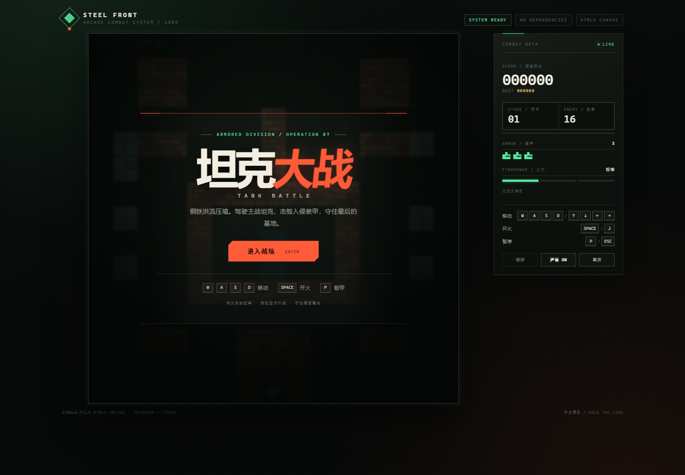
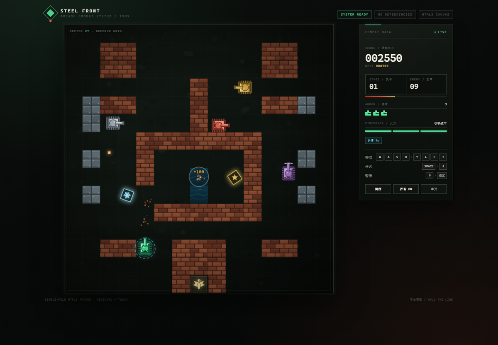

<div align="center">

# 坦克大战 · TANK BATTLE

**单文件 HTML5 Canvas 街机坦克大战**

守住鹰徽基地，击毁来袭装甲，在不断增强的钢铁洪流中尽可能走得更远。

`零依赖` · `单文件` · `键盘 / 触屏` · `本地最高分`

</div>



## 玩法

驾驶主战坦克守住屏幕下方的鹰徽基地。每一关都需要消灭全部来袭敌军；随着关卡推进，敌军数量、速度和火力都会提升。

- **基地即生命线**：基地被击毁或装甲耗尽，任务立即失败。
- **砖墙可摧毁**：砖块会被炮弹打穿，钢板需要双联破甲火力才能摧毁。
- **战术补给**：击毁敌军有概率掉落补给，提供护盾、火力、额外装甲、全屏轰炸和时间冻结。
- **无尽推进**：4 张手工地图循环使用，关卡难度持续上升。
- **本地记录**：最高分保存在浏览器 `localStorage` 中。



## 操作

| 动作 | 键盘 | 触屏 |
| --- | --- | --- |
| 移动 | `W` `A` `S` `D` / 方向键 | 左侧方向键 |
| 开火 | `Space` / `J` / `F` | 右侧 FIRE 按钮 |
| 暂停 | `P` / `Esc` | 右上角暂停按钮 |
| 静音 | `M` | 面板中的「声音」按钮 |

## 敌军与补给

| 类型 | 特点 | 分值 |
| --- | --- | --- |
| 轻型坦克 | 标准速度与火力 | 100 |
| 高速坦克 | 移动速度很快 | 200 |
| 突击坦克 | 射速快、威胁高 | 300 |
| 重甲坦克 | 需要多次命中 | 400 |

补给包括：火力强化（最多两级，二级解锁双联破甲弹）、能量护盾、装甲修复、战术轰炸、时间冻结。

## 本地运行

项目没有构建步骤，也没有第三方依赖。

```bash
git clone https://github.com/zhouzhexuan0817/tank-battle.git
cd tank-battle
```

直接双击 `index.html` 即可游玩。也可以启动一个本地静态服务器：

```bash
python -m http.server 8080
```

然后访问 <http://localhost:8080>。

## 技术实现

- 原生 HTML / CSS / JavaScript，无框架、无外部资源
- Canvas 2D 渲染：高 DPI 适配、粒子、屏幕震动、动态水面与像素风坦克
- 固定逻辑尺寸 `720 × 720`，响应式缩放适配桌面与手机
- 网格地图 + 基于 AABB 的移动与炮弹碰撞
- 加权方向决策、瞄准开火和动态刷新点的敌方 AI
- Web Audio API 合成音效
- Pointer Events 实现多点触控方向键和开火按钮

## 项目结构

```text
tank-battle/
├── index.html        # 完整游戏：界面、样式、逻辑与渲染
├── assets/           # README 截图
├── README.md
└── LICENSE
```

## License

[MIT](LICENSE) © 2026 zhouzhexuan0817
